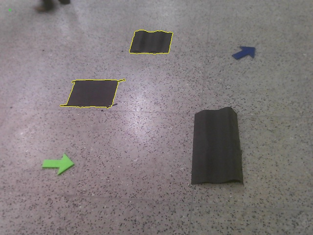
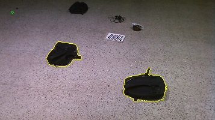
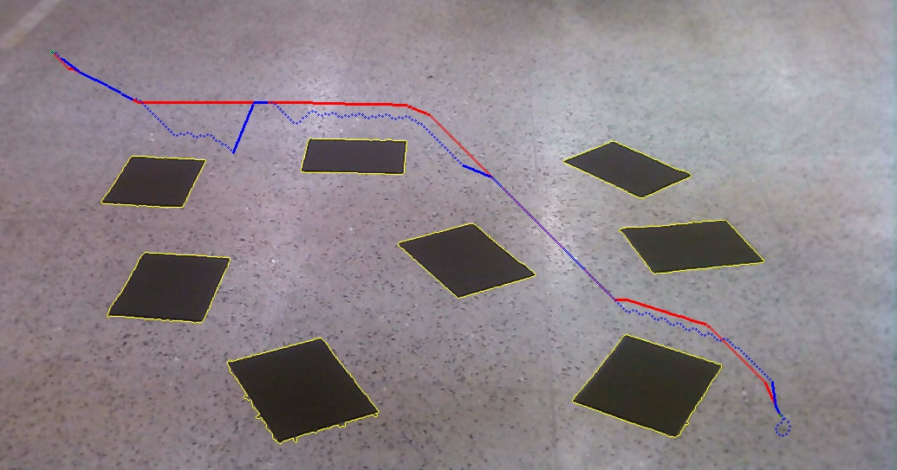

# Hybrid Artificial Potential Field & A* Path Planning

A hybrid motion planning framework combining global optimal pathfinding (**A* Search**) with real-time reactive collision avoidance (**Artificial Potential Fields**).

---

## Overview & Architecture

Standard A* search calculates global optimal paths offline, whereas Artificial Potential Fields (APF) provide reactive local obstacle avoidance. This repository implements two hybrid integration strategies:

### Strategy 1: Local Sub-Goal Decomposition (Type 1)
1. The global path is pre-computed using A*.
2. The global path is discretized into sequential local sub-goals.
3. The robot navigates between consecutive sub-goals using reactive Artificial Potential Fields.

### Strategy 2: Distance-Adaptive Switching (Type 2)
1. In open space (obstacle distance > threshold $k$), the robot follows global A* waypoints.
2. Near obstacles (obstacle distance $\le k$), control switches dynamically to Artificial Potential Fields for reactive collision avoidance.

---

## Sample Visualizations

| Sample Input Frame | Type 1 Hybrid Output | Type 2 Hybrid Output |
|---|---|---|
|  |  |  |
|  |  |  |

---

## Installation & Setup

Clone the repository and install dependencies:

```bash
git clone https://github.com/vampcoder/Hybrid-Artificial-Potential-Field-A-star-Planning.git
cd Hybrid-Artificial-Potential-Field-A-star-Planning
pip install -r requirements.txt
```

---

## Execution

Run the hybrid planning simulations:

```bash
# Run Type-1 Hybrid Planner (Sub-Goal Decomposition)
python3 A-star-potential-field-hybrid-type-1.py

# Run Type-2 Hybrid Planner (Adaptive Distance Switching)
python3 A-star-potetial-field-hybrid-type-2.py
```

---

## License

MIT License
